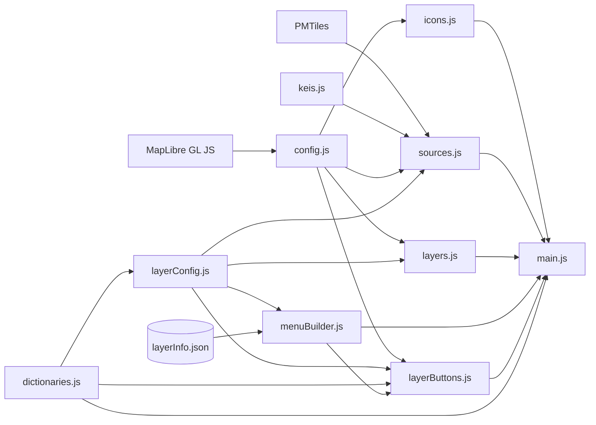

# Documentación técnica / Technical documentation

[Castellano](#castellano) | [English](#english)

---

## Castellano

### Índice

1. [Funcionamiento general](#1-funcionamiento-general)
2. [Componentes](#2-componentes)
3. [Dependencias](#3-dependencias)
4. [Modelo de configuración](#4-modelo-de-configuración)
5. [Incorporar una capa nueva](#5-incorporar-una-capa-nueva)
6. [Limitaciones conocidas](#6-limitaciones-conocidas)

---

### 1. Funcionamiento general

La herramienta es un sitio web estático escrito en HTML y JavaScript. Utiliza la biblioteca de código abierto MapLibre GL JS para representar capas georreferenciadas sobre un mapa. No necesita servidor de aplicación ni proceso de compilación. Los scripts se cargan como scripts clásicos desde `index.html` y comparten el ámbito global del navegador.

El funcionamiento se apoya en dos estructuras declarativas:

- **`LAYER_CONFIG`** (`js/layerConfig.js`). Es una matriz en la que cada objeto describe una capa del mapa: su fuente, su tipo, su estilo, su visibilidad inicial, el comportamiento de su ventana emergente y su color en el modo de gobernanza. El orden de la matriz determina el orden de renderizado: las capas que deban quedar por encima del resto se declaran al final.
- **`data/layerInfo.json`**. Describe el menú (grupos y etiquetas) y la ficha informativa de cada capa: descripción, fuente, licencia, fecha, fiabilidad y limitaciones.

El código que crea las fuentes, las capas, los botones del menú y las fichas recorre estas dos estructuras. Por eso, incorporar una capa consiste casi siempre en declarar su fuente y escribir un objeto en cada una de ellas.

Las capas obtienen sus datos de tres maneras:

| Modo de carga | Descripción | Capas actuales |
|---|---|---|
| API dinámica | El navegador consulta un servicio externo y vuelca el resultado en una fuente GeoJSON que se crea vacía. Permite disponer de datos actualizados. | Puntos de intercambio (PeeringDB); cobertura 4G y 5G (SETELECO) |
| GeoJSON local | Conjunto de datos descargado, procesado y almacenado en el repositorio. Requiere actualización manual. | Nodos y enlaces de guifi.net; cables submarinos |
| PMTiles local | Teselas vectoriales contenidas en un único archivo, para conjuntos de puntos muy grandes. Requiere actualización manual. | Antenas de OpenCelliD |

Todas las capas se superponen a una representación tridimensional del terreno y de los volúmenes edificados, que se tratan como capas base.

#### 1.1 Secuencia de arranque

1. `index.html` carga las bibliotecas externas y los scripts del proyecto (sección 3.2).
2. `config.js` crea el objeto global `map`.
3. `sources.js` registra el protocolo `pmtiles://` en MapLibre.
4. `main.js` añade los controles de escala y brújula y registra el manejador del evento `load`.
5. Cuando el estilo base termina de cargarse (`load`), se ejecutan los siguientes pasos:
   1. se configuran el cielo, el horizonte y la niebla de la vista 3D (`map.setSky`);
   2. se cargan los iconos (`cargarIcono`);
   3. se crean las fuentes (`inicializarSources`), lo que lanza además la consulta a PeeringDB;
   4. se ajustan los colores del estilo base, se activa el terreno 3D y se crean las capas (`inicializarLayers`);
   5. se construye el menú a partir de `layerInfo.json` (`construirMenu`);
   6. se conectan los botones del menú y el modo de gobernanza (`inicializarBotones`);
   7. se cargan las coberturas 4G y 5G de la extensión visible y se registra su recarga en cada evento `moveend`;
   8. se registra el manejador de clic que abre las ventanas emergentes.

El parámetro `hash: true` sincroniza la vista con la URL (centro, zoom, rotación e inclinación). Así, una vista concreta puede compartirse mediante su enlace.

---

### 2. Componentes

Estructura de archivos referenciada por el código. Las rutas de datos son relativas a `index.html`.

```
index.html
js/
  keis.js
  config.js
  dictionaries.js
  icons.js
  layerConfig.js
  sources.js
  layers.js
  menuBuilder.js
  layerButtons.js
  main.js
data/
  layerInfo.json
  guifi.net/
    guifi_links.geojson
    guifi_nodos_completo.geojson
    guifi_nodos_completo3D.geojson
  openCell/
    pmtiles/antenas.pmtiles
  subCableMap/
    subCable_spain.geojson
icons/
  LTE.png
  NR.png
  ixp.png
documentation/
  ARCHITECTURE.md
```

#### 2.1 `keis.js`

Define el objeto `KEYS`, que contiene la clave de la API de MapTiler (`KEYS.maptilerKey`). La clave incluida en el repositorio está restringida al entorno local y al dominio de publicación del proyecto. Quien despliegue la herramienta en otro dominio debe sustituirla por una propia.

#### 2.2 `config.js`

Crea la instancia global `map` (`maplibregl.Map`) en el contenedor `#mapa` con estos parámetros:

| Parámetro | Valor | Función |
|---|---|---|
| `center`, `zoom` | `[-4.663, 40.42]`, `5.3` | Vista inicial de la Península |
| `pitch` | `0` | Inclinación inicial (vista cenital) |
| `maxZoom`, `maxPitch` | `20`, `85` | Límites de navegación, que permiten la lectura a escala de edificio en 3D |
| `hash` | `true` | Sincronización de la vista con la URL |
| `style` | URL de un estilo MapLibre | Estilo del mapa base |

#### 2.3 `dictionaries.js`

Contiene las tablas que traducen identificadores oficiales a nombres comprensibles y asignan colores. También define las funciones que generan expresiones de estilo de MapLibre.

Diccionarios:

| Constante | Contenido | Uso |
|---|---|---|
| `OPERADORES` | CIF de cada operadora, con su nombre comercial, color y clave interna (fuente: einforma.com) | Traducir el campo `COBERTURA` de SETELECO y colorear por operadora |
| `OPERADORES_EXTRA` | Colores de operadoras que aparecen en las antenas pero no en la cobertura | Colorear antenas |
| `MNC_OPERADOR` | Código MNC con su clave de operadora (fuente: mcc-mnc.org) | Identificar la operadora de cada antena de OpenCelliD |
| `GOBERNANZA_OPERADOR` | Clave de operadora con su categoría de gobernanza. Telefónica se clasifica como `publica_privada` por la participación del Estado en su accionariado | Colorear antenas en el modo de gobernanza |
| `GOBERNANZA` | Categorías de gobernanza con su etiqueta y su color (sección 4.4) | Modo de gobernanza y leyenda |

Funciones:

| Función | Devuelve |
|---|---|
| `matchPorMnc(valorDe, fallback)` | Expresión `match` sobre la propiedad `mnc`, que aplica `valorDe` a la clave de cada operadora |
| `colorOperadorExpr(factor)` | Color de la operadora de cada antena, oscurecido según `factor` |
| `gobernanzaOperadorExpr()` | Color de la categoría de gobernanza de la operadora de cada antena |
| `colorPorClave(clave)` | Color hexadecimal de una operadora a partir de su clave |
| `generarGradienteVelocidad(colorBase)` | Expresión `step` sobre la propiedad `VELOCIDAD` (cobertura 5G), con umbrales en 0, 50, 100, 350 y 500 |
| `oscurecerColor(hex, factor)` | Color `rgb()` oscurecido |
| `gobernanzaColorExpr(fallback)` | Expresión `match` sobre la propiedad `governance` de cada elemento, con un color de reserva si falta |

#### 2.4 `icons.js`

Define `cargarIcono(nombre, ruta, opciones)`, una función asíncrona que carga una imagen y la registra en el mapa con el nombre indicado. Con la opción `{ sdf: true }`, el icono puede recolorearse mediante `icon-color`, que es lo que permite colorearlo por operadora o por modelo de gobernanza. Si la carga falla, el error se registra en la consola y no interrumpe la ejecución.

#### 2.5 `layerConfig.js`

Define `currentYear`, que se usa para distinguir los cables submarinos operativos de los planificados, y la matriz `LAYER_CONFIG`. La sección 4.1 describe sus campos y la sección 4.3 las capas actuales. El archivo contiene además dos bloques comentados e inactivos: uno para los cables submarinos de ámbito global y otro para generar capas de cobertura por operadora.

#### 2.6 `sources.js`

- Al cargarse, registra el protocolo `pmtiles://` (`maplibregl.addProtocol`).
- `inicializarSources()` crea las fuentes en este orden:
  1. `maptiler` (teselas vectoriales de los edificios) y `terrain-dem` (modelo digital del terreno), ambas mediante la clave de `KEYS`;
  2. las fuentes dinámicas `cobertura_5g` y `cobertura_4g`, que se crean vacías;
  3. las fuentes declaradas en `LAYER_CONFIG`, según `sourceType`: `"geojson"` crea una fuente GeoJSON con `data`; `"pmtiles"` crea una fuente vectorial con `data` como URL; `null` o una fuente ya existente no crean nada, porque la capa reutiliza una fuente declarada por otra; cualquier otro valor (por ejemplo, `"geojson-dynamic"`) indica que la fuente se crea expresamente en el paso 2;
  4. finalmente, llama a `cargarIXPs()`.
- `cargarIXPs()` consulta la API pública de PeeringDB (`/api/ix?country=ES`) y después cada punto de intercambio (`/api/ix/{id}`). Convierte las instalaciones asociadas (`fac_set`) en puntos con nombre, ciudad, dirección, fecha de creación y sitio web, y vuelca el resultado en la fuente `ixps`.
- `cargarCobertura5G()` y `cargarCobertura4G()` consultan los servicios ArcGIS que alimentan el visor oficial de SETELECO, limitando la consulta al rectángulo visible del mapa. Vuelcan el resultado en las fuentes `cobertura_5g` y `cobertura_4g`.

#### 2.7 `layers.js`

`inicializarLayers()` realiza tres operaciones:

1. Ajusta los colores de varias capas del estilo base (`water`, `water_shadow`, `waterway`, `road_path`, `road_mot_fill_noramp`). Estos identificadores deben existir en el estilo definido en `config.js`; si se cambia de estilo, hay que revisarlos.
2. Activa el terreno 3D (`map.setTerrain`) sobre la fuente `terrain-dem`.
3. Recorre `LAYER_CONFIG` y añade cada capa con su tipo, fuente, `source-layer`, filtro, zoom mínimo, propiedades `paint` y `layout`, y visibilidad inicial.

#### 2.8 `menuBuilder.js`

Genera el menú de capas y gestiona la ficha informativa de cada una. Debe ejecutarse antes que `inicializarBotones()`, porque esa función busca los botones por su identificador.

- `construirMenu()` descarga `data/layerInfo.json` y valida su coherencia con `LAYER_CONFIG`. Después crea un bloque desplegable (`<details>`) por grupo, en el orden en que aparecen en `groups`, y una fila por capa. Cada fila contiene un botón con el identificador de la capa y, si la capa tiene `info`, un botón de información.
- `validarContraLayerConfig()` avisa por la consola de tres situaciones: capas del menú que no existen en `LAYER_CONFIG`, capas de `LAYER_CONFIG` sin entrada en el menú (que no tendrán botón) y grupos inexistentes.
- `crearPanelInfo()`, `alternarInfo()`, `cerrarInfo()` y `rellenarPanel()` gestionan el panel de información. El panel muestra la descripción, la fuente con sus enlaces, la licencia, la fecha de los datos, la fiabilidad en una escala de uno a cinco con su nota, las limitaciones y la información adicional. Se cierra con la tecla Escape o al cerrar el menú.
- Todo el contenido se inserta mediante `textContent`, nunca mediante `innerHTML`.

#### 2.9 `layerButtons.js`

`inicializarBotones()` conecta la interfaz:

- **Menú de capas.** El botón `#layer-button` abre y cierra el menú `#menuCapas`.
- **Activación de capas.** Por cada objeto de `LAYER_CONFIG`, asocia el botón del mismo identificador a la propiedad `visibility` de la capa. El botón se muestra en blanco cuando la capa está visible y en gris cuando está oculta. Una capa con `linkedTo` no tiene botón propio: se muestra y se oculta con el botón de la capa indicada.
- **Terreno 3D.** El botón `hillshade` activa y desactiva además el relieve (`map.setTerrain`), que no es una propiedad de capa.
- **Modo de gobernanza.** El botón `#toggle-gobernanza` alterna, en cada capa que declara `colorBase`, entre el estilo original y el color de gobernanza (sección 4.4), y muestra la leyenda `#leyenda-gobernanza`.
- **Rangos de antenas.** `actualizarRangos()` filtra la capa `rangos` para mostrar solo el alcance de las tecnologías (LTE, NR) cuyas antenas estén visibles.
- `construirLeyendaGobernanza()` genera la leyenda a partir de `GOBERNANZA`.

#### 2.10 `main.js`

Orquesta el arranque (sección 1.1) y gestiona las ventanas emergentes. Al hacer clic, consulta los elementos visibles de las capas con `popup: true` y muestra solo el superior. Antes de mostrarlo transforma sus propiedades de este modo:

- `COBERTURA`: la lista de CIF se sustituye por los nombres comerciales de `OPERADORES`;
- `mnc`: se añade la propiedad `operadora` a partir de `MNC_OPERADOR`;
- `link`: uno o varios enlaces, como cadena, matriz o matriz serializada, se convierten en hipervínculos;
- se excluyen `name` y las propiedades de `popupExclude`.

El título de la ventana es `NODE_NAME`, `name` o la lista de operadoras, por este orden de preferencia. En las capas de cobertura se añade la tecnología (LTE 4G o NR 5G). Si el elemento tiene `url`, se añade un enlace al final.

---

### 3. Dependencias

#### 3.1 Dependencias externas

| Dependencia | Tipo | Uso |
|---|---|---|
| MapLibre GL JS (`maplibregl`) | Biblioteca | Representación del mapa |
| PMTiles (`pmtiles`) | Biblioteca | Lectura de archivos PMTiles mediante el protocolo `pmtiles://` |
| MapTiler | Servicio con clave | Teselas de edificios y modelo digital del terreno |
| Estilo base (`config.js`) | Servicio | Mapa base vectorial |
| PeeringDB | API pública | Puntos de intercambio, consultados en tiempo real |
| SETELECO (ArcGIS) | Servicio público sin documentación | Cobertura 4G y 5G por extensión visible |

Herramientas de preparación de datos (no se ejecutan en el navegador): Python con GeoPandas y Shapely para generar los GeoJSON, y Tippecanoe para convertirlos a PMTiles.

#### 3.2 Orden de carga

Los scripts comparten el ámbito global. Por eso, un script que usa en su nivel superior algo definido por otro debe cargarse después. Este orden respeta todas las dependencias:

1. MapLibre GL JS
2. PMTiles
3. `keis.js`
4. `config.js`
5. `dictionaries.js`
6. `icons.js`
7. `layerConfig.js`
8. `sources.js`
9. `layers.js`
10. `menuBuilder.js`
11. `layerButtons.js`
12. `main.js`

Si se modifica `index.html`, deben respetarse al menos estas restricciones:

- `config.js` después de MapLibre, porque crea el mapa al cargarse.
- `layerConfig.js` después de `dictionaries.js`, porque `LAYER_CONFIG` invoca funciones de estilo al definirse.
- `sources.js` después de MapLibre y PMTiles, porque registra el protocolo al cargarse.
- `main.js` el último, porque registra controles sobre `map` y llama durante el evento `load` a funciones definidas en todos los demás.

#### 3.3 Dependencias entre scripts

Se distingue entre dependencia de carga (el símbolo se usa al evaluar el archivo) y dependencia de ejecución (el símbolo se usa dentro de funciones invocadas después).

| Script | Define | Depende de (carga) | Depende de (ejecución) |
|---|---|---|---|
| `keis.js` | `KEYS` | — | — |
| `config.js` | `map` | `maplibregl` | — |
| `dictionaries.js` | Diccionarios y funciones de estilo (2.3) | — | — |
| `icons.js` | `cargarIcono` | — | `map` |
| `layerConfig.js` | `currentYear`, `LAYER_CONFIG` | `dictionaries.js` | — |
| `sources.js` | `inicializarSources`, `cargarIXPs`, `cargarCobertura5G`, `cargarCobertura4G` | `maplibregl`, `pmtiles` | `map`, `KEYS`, `LAYER_CONFIG` |
| `layers.js` | `inicializarLayers` | — | `map`, `LAYER_CONFIG` |
| `menuBuilder.js` | `construirMenu` y funciones del panel | — | `LAYER_CONFIG`, `data/layerInfo.json` |
| `layerButtons.js` | `inicializarBotones`, `construirLeyendaGobernanza` | — | `map`, `LAYER_CONFIG`, `GOBERNANZA`, `gobernanzaColorExpr`, botones creados por `menuBuilder.js` |
| `main.js` | Controles y manejadores de eventos | `map`, `maplibregl` | Todos los anteriores, `OPERADORES`, `MNC_OPERADOR` |

En el diagrama, cada flecha indica que el script de destino depende del de origen:



#### 3.4 Elementos del DOM requeridos

| Elemento | Usado por |
|---|---|
| `#mapa` | `config.js` (contenedor del mapa) |
| `#layer-button`, `#menuCapas` | `layerButtons.js`, `menuBuilder.js` |
| `#menu-grupos` | `menuBuilder.js` (contenedor de los grupos de capas) |
| Elemento con clase `.info` | `menuBuilder.js` (contenedor del panel de información) |
| `#toggle-gobernanza`, `#leyenda-gobernanza` | `layerButtons.js` |
| Botones `#antenas_LTE`, `#antenas_NR` | `layerButtons.js` (`actualizarRangos`); se generan desde `layerInfo.json` y deben existir en él |

Clases CSS que aplica el código: `visible`, `layer-row`, `layer-info-btn`, `activo`, `layer-info-panel`, `layer-info-close`, `layer-info-desc`, `fiab-puntos`, `fiab-nota`, `leyenda-item` y `gobernanza-activa`.

---

### 4. Modelo de configuración

#### 4.1 Campos de `LAYER_CONFIG`

| Campo | Obligatorio | Descripción |
|---|---|---|
| `id` | Sí | Identificador único de la capa. Debe coincidir con la clave de la capa en `layerInfo.json`. |
| `categoria` | Recomendado | Modelo de gobernanza de la infraestructura (`publica`, `privada`, `comunitaria`, `mixta`) o `base`. Tiene función documental: el código actual no lo lee. |
| `sourceId` | Sí | Identificador de la fuente. Varias capas pueden compartirlo. |
| `sourceType` | Sí | `"geojson"`, `"pmtiles"`, `null` (reutiliza una fuente existente) o un valor propio (por ejemplo, `"geojson-dynamic"`) para fuentes creadas expresamente en `sources.js`. |
| `data` | Según el tipo | Ruta o URL del GeoJSON, objeto GeoJSON vacío para fuentes dinámicas, o URL `pmtiles://` para PMTiles. |
| `sourceLayer` | En fuentes vectoriales | Nombre de la capa interna de las teselas. En PMTiles, el indicado con `-l` en Tippecanoe. |
| `layerType` | Sí | Tipo de capa de MapLibre: `fill`, `line`, `circle`, `symbol`, `fill-extrusion`, `hillshade`… |
| `filter` | No | Expresión de filtro de MapLibre. |
| `minzoom` | No | Zoom a partir del cual la capa se muestra. |
| `paint`, `layout` | No | Propiedades de estilo de MapLibre. `visibility` se añade automáticamente. |
| `colorBase` | Para el modo de gobernanza | Objeto `{ prop, expr, gov }` o matriz de ellos (sección 4.4). |
| `visibleByDefault` | Sí | Visibilidad inicial. |
| `popup` | Sí | `true` si la capa abre ventana emergente al hacer clic. |
| `popupExclude` | No | Propiedades que no se muestran en la ventana emergente. |
| `linkedTo` | No | Identificador de otra capa cuyo botón controla también esta. |
| `label`, `grupo` | No | Campos descriptivos que el código actual no usa. La etiqueta del menú se toma de `layerInfo.json`. |

`inicializarLayers()` solo transfiere a MapLibre los campos de la tabla. Para usar otras propiedades de capa (por ejemplo, `maxzoom`), hay que añadirlas en esa función.

#### 4.2 Estructura de `data/layerInfo.json`

```json
{
  "meta": {
    "fiabilityScale": ["nivel 1", "nivel 2", "nivel 3", "nivel 4", "nivel 5"]
  },
  "groups": {
    "id_grupo": { "title": "Título del grupo", "open": true }
  },
  "layers": {
    "id_capa": {
      "group": "id_grupo",
      "label": "Etiqueta en el menú",
      "info": {
        "description": "Descripción del elemento infraestructural.",
        "source": "Nombre de la fuente.",
        "link": ["https://..."],
        "license": "Licencia de uso.",
        "date": "Fecha de los datos.",
        "fiability": { "level": 4, "note": "Justificación del nivel." },
        "limitations": "Limitaciones encontradas.",
        "moreinfo": "Información adicional (por ejemplo, legislación aplicable)."
      }
    }
  }
}
```

- `meta.fiabilityScale` contiene las cinco etiquetas de la escala de fiabilidad, ordenadas del nivel 1 al 5.
- El orden de `groups` determina el orden del menú, y `open` indica si el grupo aparece desplegado.
- El orden de las capas dentro de cada grupo es el de `layers`.
- Todos los campos de `info` son opcionales. `link` admite una cadena o una matriz. Si no hay `info`, la capa no tiene botón de información.

#### 4.3 Capas actuales

La columna de gobernanza recoge la clasificación de la infraestructura que establece la investigación.

| `id` | Elemento | `sourceType` | Gobernanza de la infraestructura |
|---|---|---|---|
| `hillshade` | Relieve y terreno 3D | `null` (`terrain-dem`) | Capa base |
| `edificios-3d` | Volúmenes edificados (desde zoom 13) | `null` (`maptiler`) | Capa base |
| `cobertura_4g` | Cobertura 4G (desde zoom 13) | `geojson-dynamic` | Privada; mixta |
| `cobertura_5g` | Cobertura 5G con gradiente de velocidad (desde zoom 13) | `geojson-dynamic` | Privada; mixta |
| `rangos` | Alcance estimado de las antenas | `pmtiles` | Privada; mixta |
| `antenas_LTE`, `antenas_NR` | Antenas LTE (4G) y NR (5G) | `null` (`antenas`) | Privada; mixta |
| `guifi_links` | Enlaces de guifi.net | `geojson` | Comunitaria; mixta en colaboraciones con municipios |
| `guifi_nodos_2d` | Nodos de guifi.net | `geojson` | Comunitaria; mixta en colaboraciones con municipios |
| `guifi_nodos_3d` | Altura de instalación de los nodos (desde zoom 16) | `geojson` | Comunitaria; mixta en colaboraciones con municipios |
| `cables_sub_spain` | Cables submarinos operativos | `geojson` | Privada o mixta (consorcios) |
| `cables_sub_spain_planned` | Cables submarinos planificados (línea discontinua) | `geojson` (fuente compartida) | Privada o mixta (consorcios) |
| `ixps` | Puntos de intercambio de Internet | `geojson` (cargada desde la API) | Mixta |

Las rutas de fibra óptica y la red RedIRIS no tienen capa en `LAYER_CONFIG`. Se documentan como capas ausentes (sección 5.6).

#### 4.4 Modo de gobernanza

La herramienta reduce la gobernanza de la infraestructura a cuatro modelos: pública, privada, comunitaria y mixta. La asignación se basa en la propiedad. `GOBERNANZA` define además combinaciones concretas del modelo mixto, representadas con colores intermedios entre los de los modelos que combinan:

| Clave | Etiqueta en la leyenda | Color | Modelo |
|---|---|---|---|
| `publica` | publica | `#3b3ef6` | Pública |
| `privada` | privada | `#ff00a2` | Privada |
| `comunitaria` | comunitaria | `#08e97c` | Comunitaria |
| `mixta` | mixta | `#ffffff` | Mixta |
| `publica_privada` | publica-privada | `#b007e8` | Mixta (pública y privada) |
| `publica_comunitaria` | publica-comunitaria | `#22cdd3` | Mixta (pública y comunitaria) |
| `comunitaria_privada` | comunitaria-privada | `#ade629` | Mixta (comunitaria y privada) |
| `nodata` | sin datos | `#666666` | Sin clasificar |

Al activar el modo, cada capa con `colorBase` cambia la propiedad `prop` al valor de `gov`. Si no hay `gov`, se usa `gobernanzaColorExpr()`, que lee la propiedad `governance` de cada elemento y recurre a `nodata` si falta. Al desactivarlo, se restaura `expr`, que debe coincidir con el valor original de `paint`. Las capas sin `colorBase` conservan su estilo.

`gov` admite tres formas:

- un color fijo, por ejemplo `GOBERNANZA.privada.color`;
- `gobernanzaColorExpr("categoria")`, que lee la propiedad `governance` de cada elemento con la categoría indicada como reserva (así funcionan las capas de guifi.net);
- una expresión propia, como `gobernanzaOperadorExpr()` en las antenas, que deduce la categoría de la operadora a partir del MNC.

La clasificación del modo de gobernanza corresponde al primer eje de la investigación, la gobernanza de la infraestructura. El segundo eje, la gobernanza del dato (fuente, licencia y legislación), se registra en la ficha informativa de cada capa (`layerInfo.json`) y en el README.

---

### 5. Incorporar una capa nueva

#### 5.1 Pasos comunes

1. **Evaluar la fuente.** Hay que comprobar la disponibilidad y la fiabilidad de los datos, la viabilidad técnica de adaptarlos al formato de la herramienta, la licencia de reutilización y la legislación aplicable. También hay que identificar los dos ejes de gobernanza: quién gobierna la infraestructura y quién produce y gobierna el registro.
2. **Elegir el modo de carga.**
   - API dinámica: la fuente ofrece un servicio consultable desde el navegador y conviene mantener los datos actualizados (caso A).
   - GeoJSON local: conjuntos de tamaño moderado (caso B).
   - PMTiles local: conjuntos de puntos muy grandes (caso C).
3. **Declarar la capa en `LAYER_CONFIG`**, en la posición que corresponda a su orden de renderizado.
4. **Declarar su gobernanza.** Hay que indicar `categoria` y definir `colorBase` con un `gov` adecuado o, si la gobernanza varía entre elementos, incluir la propiedad `governance` en los datos con una de las claves de `GOBERNANZA`.
5. **Añadir la entrada en `data/layerInfo.json`**, con el mismo `id`, el grupo, la etiqueta y la ficha informativa. Sin esta entrada, la capa no tiene botón.
6. **Iconos.** Si la capa es de tipo `symbol`, hay que guardar el PNG en `icons/` y cargarlo en `main.js` con `cargarIcono` antes de `inicializarLayers()`. Para que el icono pueda recolorearse, se usa `{ sdf: true }`.
7. **Identificadores.** Si los datos contienen códigos poco legibles (CIF, MNC u otros), hay que añadir el diccionario correspondiente en `dictionaries.js` y su traducción en el manejador de clic de `main.js`.
8. **Comprobar y documentar** según la lista de la sección 5.7, y añadir la fuente y su licencia al README.

#### 5.2 Caso A1: API dinámica con carga única

Este patrón corresponde a datos que no dependen de la vista, como los puntos de intercambio de PeeringDB.

1. Comprobar que la API admite peticiones desde el navegador (CORS). Si requiere clave, añadirla a `KEYS` en `keis.js`, teniendo en cuenta que será visible en el código cliente.
2. Declarar la capa con una fuente GeoJSON vacía. El bucle genérico de `inicializarSources()` la crea.

```js
// js/layerConfig.js, dentro de LAYER_CONFIG
{
  id: "nueva_capa_api",
  categoria: "mixta",
  sourceId: "nueva_capa_api",
  sourceType: "geojson",
  data: { type: "FeatureCollection", features: [] }, // se rellena desde la API
  layerType: "circle",
  paint: { "circle-radius": 5, "circle-color": "#e0e0e0" },
  colorBase: { prop: "circle-color", expr: "#e0e0e0", gov: gobernanzaColorExpr("mixta") },
  visibleByDefault: true,
  popup: true,
  popupExclude: ["url"], // la url se muestra como enlace al pie de la ventana
},
```

3. Escribir en `sources.js` la función que consulta la API, convierte la respuesta en elementos GeoJSON (coordenadas en el orden longitud, latitud) y los vuelca en la fuente. Después, llamarla al final de `inicializarSources()`, como `cargarIXPs()`.

```js
// js/sources.js
function cargarNuevaCapaApi() {
  fetch("https://api.ejemplo.org/v1/elementos?pais=ES")
    .then((r) => {
      if (!r.ok) throw new Error(`HTTP ${r.status}`);
      return r.json();
    })
    .then((respuesta) => {
      const features = respuesta.elementos.map((e) => ({
        type: "Feature",
        geometry: { type: "Point", coordinates: [e.longitud, e.latitud] },
        properties: { name: e.nombre, governance: "mixta", url: e.web },
      }));
      map.getSource("nueva_capa_api").setData({ type: "FeatureCollection", features });
    })
    .catch((err) => console.error("No se pudo cargar nueva_capa_api:", err));
}

// al final de inicializarSources():
cargarNuevaCapaApi();
```

4. Completar los pasos comunes 5 a 8.

#### 5.3 Caso A2: API dinámica por extensión visible

Este patrón corresponde a servicios voluminosos que se consultan por zonas, como la cobertura de SETELECO.

1. Comprobar que el servicio admite consultas por rectángulo envolvente y peticiones desde el navegador, y averiguar su número máximo de registros por consulta.
2. Declarar la capa con un `sourceType` propio. El bucle genérico ignora ese valor, y la fuente se crea expresamente en el paso 3. Conviene fijar `minzoom` para que la capa se lea a escala cercana.

```js
// js/layerConfig.js, dentro de LAYER_CONFIG
{
  id: "nueva_capa_extension",
  categoria: "privada",
  sourceId: "nueva_capa_extension",
  sourceType: "geojson-dynamic", // la fuente se crea en inicializarSources()
  layerType: "fill",
  minzoom: 13,
  paint: { "fill-color": "#a2a7ca77" },
  colorBase: { prop: "fill-color", expr: "#a2a7ca77", gov: gobernanzaColorExpr("privada") },
  visibleByDefault: false,
  popup: true,
},
```

3. Crear la fuente vacía en `inicializarSources()`, antes del bucle genérico, y escribir la función de carga. Se recomienda que no consulte el servicio por debajo del zoom mínimo de la capa, para evitar peticiones a escala nacional.

```js
// js/sources.js, dentro de inicializarSources(), antes del bucle genérico
map.addSource("nueva_capa_extension", {
  type: "geojson",
  data: { type: "FeatureCollection", features: [] },
});

// js/sources.js, función de carga
const ZOOM_MIN_NUEVA_CAPA = 13; // igual que minzoom de la capa

function cargarNuevaCapaExtension() {
  if (map.getZoom() < ZOOM_MIN_NUEVA_CAPA) return;
  const b = map.getBounds();
  const bbox = `${b.getWest()},${b.getSouth()},${b.getEast()},${b.getNorth()}`;
  const url =
    "https://servicio.ejemplo.org/arcgis/rest/services/Capa/FeatureServer/0/query" +
    `?f=geojson&where=1=1&outFields=CAMPO_A,CAMPO_B&geometry=${bbox}` +
    "&geometryType=esriGeometryEnvelope&inSR=4326&outSR=4326";
  fetch(url)
    .then((r) => r.json())
    .then((data) => map.getSource("nueva_capa_extension").setData(data))
    .catch((err) => console.error("No se pudo cargar nueva_capa_extension:", err));
}
```

4. Registrar la carga en `main.js`, dentro de `map.on("load", ...)` y después de `inicializarBotones()`:

```js
// js/main.js
cargarNuevaCapaExtension();
map.on("moveend", cargarNuevaCapaExtension);
```

5. Completar los pasos comunes 5 a 8.

#### 5.4 Caso B: conjunto de datos local en GeoJSON

1. Descargar los datos y registrar su licencia y su fecha.
2. Procesarlos con Python (GeoPandas y Shapely):
   - reproyectarlos a WGS84 (EPSG:4326), como exige GeoJSON;
   - si son de ámbito internacional, filtrarlos con las unidades administrativas de primer orden del IGN;
   - conservar solo las propiedades necesarias, para reducir el tamaño;
   - añadir `name` (título de la ventana emergente) y, si procede, `governance` y `url`.

```python
import geopandas as gpd

datos = gpd.read_file("origen/datos_originales.gpkg").to_crs(epsg=4326)

# Filtrado al territorio español con las unidades administrativas del IGN
limites = gpd.read_file("origen/ign_unidades_primer_orden.shp").to_crs(epsg=4326)
espana = limites.union_all()  # unary_union en versiones de GeoPandas anteriores a la 1.0
datos = datos[datos.intersects(espana)]

# Propiedades para la ventana emergente y el modo de gobernanza
datos = datos[["nombre", "propietario", "geometry"]].rename(columns={"nombre": "name"})
datos["governance"] = "privada"

datos.to_file("data/nueva_fuente/nueva_capa.geojson", driver="GeoJSON")
```

3. Guardar el archivo en `data/<fuente>/` y declarar la capa:

```js
// js/layerConfig.js, dentro de LAYER_CONFIG
{
  id: "nueva_capa_geojson",
  categoria: "privada",
  sourceId: "nueva_capa_geojson",
  sourceType: "geojson",
  data: "./data/nueva_fuente/nueva_capa.geojson",
  layerType: "line",
  paint: { "line-color": "#c8c8c8", "line-width": 2, "line-opacity": 0.7 },
  colorBase: { prop: "line-color", expr: "#c8c8c8" }, // sin gov: usa la propiedad governance
  visibleByDefault: true,
  popup: true,
},
```

4. Para representar los mismos datos de otra forma (por ejemplo, filtrados por año, como los cables planificados), se declara otra capa con el mismo `sourceId`. La fuente solo se crea una vez.
5. Completar los pasos comunes 5 a 8.

El navegador carga el archivo GeoJSON completo. Para conjuntos de puntos muy grandes, conviene usar PMTiles (caso C).

#### 5.5 Caso C: conjunto de datos local en PMTiles

1. Preparar un GeoJSON según los pasos 1 y 2 del caso B.
2. Convertirlo a PMTiles con Tippecanoe. La opción `-l` define el nombre de la capa interna (`sourceLayer`), y `-Z` y `-z` definen los niveles de zoom mínimo y máximo de las teselas. Por debajo de `-Z` no se muestran elementos. Las opciones `-y` (conservar) y `-x` (excluir) permiten seleccionar atributos.

```bash
tippecanoe -o data/nueva_fuente/pmtiles/nueva_capa.pmtiles \
  -l nueva_capa -Z8 -z16 \
  --no-tile-size-limit --no-feature-limit \
  nueva_capa.geojson
```

3. Declarar la capa. El protocolo `pmtiles://` ya está registrado en `sources.js`. Las capas adicionales sobre el mismo archivo reutilizan la fuente con `sourceType: null`; basta con que una de ellas declare `sourceType` y `data`.

```js
// js/layerConfig.js, dentro de LAYER_CONFIG
{
  id: "nueva_capa_pmtiles",
  categoria: "comunitaria",
  sourceId: "nueva_capa_pmtiles",
  sourceType: "pmtiles",
  data: "pmtiles://./data/nueva_fuente/pmtiles/nueva_capa.pmtiles",
  sourceLayer: "nueva_capa", // nombre indicado con -l
  layerType: "circle",
  paint: { "circle-radius": 3, "circle-color": "#e0e0e0" },
  colorBase: { prop: "circle-color", expr: "#e0e0e0", gov: gobernanzaColorExpr("comunitaria") },
  visibleByDefault: false,
  popup: true,
},
{
  id: "nueva_capa_pmtiles_activos",
  sourceId: "nueva_capa_pmtiles",
  sourceType: null, // reutiliza la fuente anterior
  sourceLayer: "nueva_capa",
  layerType: "circle",
  filter: ["==", ["get", "estado"], "activo"],
  paint: { "circle-radius": 4, "circle-color": "#ffffff" },
  visibleByDefault: false,
  popup: true,
},
```

4. Servir la herramienta desde un servidor HTTP. PMTiles se lee mediante peticiones por rangos, que no funcionan abriendo el archivo directamente desde el disco.
5. Completar los pasos comunes 5 a 8.

#### 5.6 Capas ausentes documentadas

Algunos elementos no pueden representarse porque no existen datos reutilizables; es el caso de las rutas de fibra óptica y de la red RedIRIS. Estas ausencias se muestran en lugar de ocultarse. Para ello, se añade una entrada en `layerInfo.json` sin objeto correspondiente en `LAYER_CONFIG`, con una ficha que explique por qué no se pudo obtener el dato y qué normativa restringe su acceso.

El botón aparece en el menú con su ficha informativa, pero no está conectado a ninguna capa. `validarContraLayerConfig()` emite un aviso en la consola, que en este caso es esperado. El aspecto desactivado del botón depende de la hoja de estilos.

#### 5.7 Lista de comprobación

- La consola no muestra avisos de `validarContraLayerConfig()`, salvo los de las capas ausentes.
- El botón activa y desactiva la capa, y las capas con `linkedTo` lo siguen.
- La ficha informativa muestra fuente, licencia, fecha, fiabilidad y limitaciones.
- El modo de gobernanza colorea la capa con la categoría esperada y restaura su estilo al desactivarse.
- La ventana emergente muestra un título, oculta las propiedades técnicas y traduce los identificadores.
- La capa se comporta correctamente en los extremos de su rango de zoom y sobre el terreno 3D.
- El README recoge la fuente, la licencia y la gobernanza de la nueva capa.

---

### 6. Limitaciones conocidas

- La clave de MapTiler es comercial. Sustituirla por teselas libres servidas sin clave eliminaría esta dependencia.
- Las fuentes dinámicas dependen de la disponibilidad y de las políticas de acceso de servicios externos. El servicio ArcGIS de SETELECO no está documentado y puede cambiar sin aviso.
- Los conjuntos de datos locales requieren actualización manual y tienen fechas y resoluciones distintas.
- Los dos ejes de gobernanza (de la infraestructura y del dato) todavía no son atributos separados en la configuración. El primero se expresa en `categoria` y `colorBase`, y el segundo en la ficha informativa.
- Todos los scripts comparten el ámbito global. Las funciones y constantes nuevas deben tener nombres que no coincidan con los existentes.
- Ampliar la herramienta requiere conocimientos de JavaScript, de MapLibre, de Python y del manejo de datos geolocalizados.

---

## English

### Contents

1. [General operation](#1-general-operation)
2. [Components](#2-components)
3. [Dependencies](#3-dependencies)
4. [Configuration model](#4-configuration-model)
5. [Adding a new layer](#5-adding-a-new-layer)
6. [Known limitations](#6-known-limitations)

---

### 1. General operation

The tool is a static website written in HTML and JavaScript. It uses the open-source library MapLibre GL JS to display georeferenced layers on a map. It needs no application server and no build process. The scripts are loaded as classic scripts from `index.html` and share the browser's global scope.

The tool rests on two declarative structures:

- **`LAYER_CONFIG`** (`js/layerConfig.js`). An array in which each object describes one map layer: its source, type, styling, initial visibility, pop-up behaviour and colour in governance mode. The order of the array sets the rendering order: layers that must sit above the others are declared last.
- **`data/layerInfo.json`**. Describes the menu (groups and labels) and the information card of each layer: description, source, licence, date, reliability and limitations.

The code that creates sources, layers, menu buttons and information cards iterates over these two structures. Adding a layer therefore usually means declaring its source and writing one object in each of them.

Layers obtain their data in three ways:

| Loading mode | Description | Current layers |
|---|---|---|
| Dynamic API | The browser queries an external service and loads the result into a GeoJSON source that starts empty. Keeps data up to date. | Internet exchange points (PeeringDB); 4G and 5G coverage (SETELECO) |
| Local GeoJSON | A dataset downloaded, processed and stored in the repository. Requires manual updating. | guifi.net nodes and links; submarine cables |
| Local PMTiles | Vector tiles held in a single file, for very large point sets. Requires manual updating. | OpenCelliD antennas |

All layers are overlaid on a three-dimensional representation of the terrain and of building volumes, both treated as base layers.

#### 1.1 Start-up sequence

1. `index.html` loads the external libraries and the project scripts (section 3.2).
2. `config.js` creates the global `map` object.
3. `sources.js` registers the `pmtiles://` protocol with MapLibre.
4. `main.js` adds the scale and compass controls and registers the `load` event handler.
5. When the base style has loaded (`load`), the following steps run:
   1. the sky, horizon and fog of the 3D view are configured (`map.setSky`);
   2. the icons are loaded (`cargarIcono`);
   3. the sources are created (`inicializarSources`), which also launches the PeeringDB query;
   4. the base style colours are adjusted, 3D terrain is enabled and the layers are created (`inicializarLayers`);
   5. the menu is built from `layerInfo.json` (`construirMenu`);
   6. the menu buttons and governance mode are wired up (`inicializarBotones`);
   7. 4G and 5G coverage for the visible extent is loaded, and reloading is registered on every `moveend` event;
   8. the click handler that opens pop-ups is registered.

The `hash: true` option synchronises the view with the URL (centre, zoom, bearing and pitch), so that a given view can be shared through its link.

---

### 2. Components

File structure referenced by the code. Data paths are relative to `index.html`.

```
index.html
js/
  keis.js
  config.js
  dictionaries.js
  icons.js
  layerConfig.js
  sources.js
  layers.js
  menuBuilder.js
  layerButtons.js
  main.js
data/
  layerInfo.json
  guifi.net/
    guifi_links.geojson
    guifi_nodos_completo.geojson
    guifi_nodos_completo3D.geojson
  openCell/
    pmtiles/antenas.pmtiles
  subCableMap/
    subCable_spain.geojson
icons/
  LTE.png
  NR.png
  ixp.png
documentation/
  ARCHITECTURE.md
```

#### 2.1 `keis.js`

Defines the `KEYS` object, which holds the MapTiler API key (`KEYS.maptilerKey`). The key included in the repository is restricted to local use and to the project's publication domain. Anyone deploying the tool on another domain must replace it with their own.

#### 2.2 `config.js`

Creates the global `map` instance (`maplibregl.Map`) in the `#mapa` container with these options:

| Option | Value | Purpose |
|---|---|---|
| `center`, `zoom` | `[-4.663, 40.42]`, `5.3` | Initial view of the Iberian Peninsula |
| `pitch` | `0` | Initial tilt (top-down view) |
| `maxZoom`, `maxPitch` | `20`, `85` | Navigation limits, allowing 3D reading at building scale |
| `hash` | `true` | Synchronises the view with the URL |
| `style` | URL of a MapLibre style | Basemap style |

#### 2.3 `dictionaries.js`

Holds the tables that translate official identifiers into readable names and assign colours. It also defines the functions that build MapLibre style expressions.

Dictionaries:

| Constant | Content | Use |
|---|---|---|
| `OPERADORES` | Each operator's tax identification number (CIF), with its trade name, colour and internal key (source: einforma.com) | Translating SETELECO's `COBERTURA` field and colouring by operator |
| `OPERADORES_EXTRA` | Colours of operators that appear among antennas but not in coverage data | Colouring antennas |
| `MNC_OPERADOR` | Mobile network code (MNC) and its operator key (source: mcc-mnc.org) | Identifying the operator of each OpenCelliD antenna |
| `GOBERNANZA_OPERADOR` | Operator key and its governance category. Telefónica is classed as `publica_privada` because of the State's shareholding | Colouring antennas in governance mode |
| `GOBERNANZA` | Governance categories with their label and colour (section 4.4) | Governance mode and legend |

Functions:

| Function | Returns |
|---|---|
| `matchPorMnc(valorDe, fallback)` | A `match` expression on the `mnc` property that applies `valorDe` to each operator key |
| `colorOperadorExpr(factor)` | The colour of each antenna's operator, darkened by `factor` |
| `gobernanzaOperadorExpr()` | The governance-category colour of each antenna's operator |
| `colorPorClave(clave)` | An operator's hexadecimal colour from its key |
| `generarGradienteVelocidad(colorBase)` | A `step` expression on the `VELOCIDAD` property (5G coverage), with thresholds at 0, 50, 100, 350 and 500 |
| `oscurecerColor(hex, factor)` | A darkened `rgb()` colour |
| `gobernanzaColorExpr(fallback)` | A `match` expression on each feature's `governance` property, with a fallback colour if it is missing |

#### 2.4 `icons.js`

Defines `cargarIcono(nombre, ruta, opciones)`, an asynchronous function that loads an image and registers it with the map under the given name. With `{ sdf: true }` the icon can be recoloured through `icon-color`, which is what allows colouring by operator or by governance model. If loading fails, the error is logged to the console and execution continues.

#### 2.5 `layerConfig.js`

Defines `currentYear`, used to distinguish operational from planned submarine cables, and the `LAYER_CONFIG` array. Section 4.1 describes its fields and section 4.3 the current layers. The file also contains two inactive, commented-out blocks: one for global submarine cables and one that generates coverage layers per operator.

#### 2.6 `sources.js`

- On loading, it registers the `pmtiles://` protocol (`maplibregl.addProtocol`).
- `inicializarSources()` creates the sources in this order:
  1. `maptiler` (vector tiles for buildings) and `terrain-dem` (digital elevation model), both through the key in `KEYS`;
  2. the dynamic sources `cobertura_5g` and `cobertura_4g`, created empty;
  3. the sources declared in `LAYER_CONFIG`, according to `sourceType`: `"geojson"` creates a GeoJSON source from `data`; `"pmtiles"` creates a vector source with `data` as its URL; `null`, or a source that already exists, creates nothing, because the layer reuses a source declared by another; any other value (for example `"geojson-dynamic"`) signals a source created explicitly in step 2;
  4. finally, it calls `cargarIXPs()`.
- `cargarIXPs()` queries PeeringDB's public API (`/api/ix?country=ES`) and then each exchange point (`/api/ix/{id}`). It turns the associated facilities (`fac_set`) into points with name, city, address, creation date and website, and loads the result into the `ixps` source.
- `cargarCobertura5G()` and `cargarCobertura4G()` query the ArcGIS services behind SETELECO's official viewer, limited to the visible map extent. They load the results into the `cobertura_5g` and `cobertura_4g` sources.

#### 2.7 `layers.js`

`inicializarLayers()` performs three operations:

1. It adjusts the colours of several base-style layers (`water`, `water_shadow`, `waterway`, `road_path`, `road_mot_fill_noramp`). These identifiers must exist in the style set in `config.js`; if the style changes, they must be reviewed.
2. It enables 3D terrain (`map.setTerrain`) on the `terrain-dem` source.
3. It iterates over `LAYER_CONFIG` and adds each layer with its type, source, `source-layer`, filter, minimum zoom, `paint` and `layout` properties, and initial visibility.

#### 2.8 `menuBuilder.js`

Generates the layer menu and manages each layer's information card. It must run before `inicializarBotones()`, because that function looks up the buttons by their identifiers.

- `construirMenu()` fetches `data/layerInfo.json` and checks it against `LAYER_CONFIG`. It then creates one collapsible block (`<details>`) per group, in the order in which groups appear in `groups`, and one row per layer. Each row holds a button with the layer's identifier and, if the layer has `info`, an information button.
- `validarContraLayerConfig()` logs a console warning in three situations: menu layers that do not exist in `LAYER_CONFIG`, `LAYER_CONFIG` layers with no menu entry (which will have no button), and non-existent groups.
- `crearPanelInfo()`, `alternarInfo()`, `cerrarInfo()` and `rellenarPanel()` manage the information panel. The panel shows the description, the source with its links, the licence, the date of the data, reliability on a scale of one to five with its note, the limitations and further information. It closes with the Escape key or when the menu is closed.
- All content is inserted through `textContent`, never through `innerHTML`.

#### 2.9 `layerButtons.js`

`inicializarBotones()` wires up the interface:

- **Layer menu.** The `#layer-button` button opens and closes the `#menuCapas` menu.
- **Layer toggles.** For each object in `LAYER_CONFIG`, it binds the button with the same identifier to the layer's `visibility` property. The button is shown in white when the layer is visible and in grey when hidden. A layer with `linkedTo` has no button of its own: it is shown and hidden with the button of the layer it names.
- **3D terrain.** The `hillshade` button also toggles the relief (`map.setTerrain`), which is not a layer property.
- **Governance mode.** The `#toggle-gobernanza` button switches every layer that declares `colorBase` between its original styling and its governance colour (section 4.4), and shows the `#leyenda-gobernanza` legend.
- **Antenna ranges.** `actualizarRangos()` filters the `rangos` layer so that it shows only the range of those technologies (LTE, NR) whose antennas are visible.
- `construirLeyendaGobernanza()` builds the legend from `GOBERNANZA`.

#### 2.10 `main.js`

Orchestrates start-up (section 1.1) and manages pop-ups. On click, it queries the rendered features of layers with `popup: true` and shows only the topmost one. Before displaying it, it transforms the feature's properties as follows:

- `COBERTURA`: the list of tax identification numbers is replaced with the trade names in `OPERADORES`;
- `mnc`: an `operadora` property is added from `MNC_OPERADOR`;
- `link`: one or more links, given as a string, an array or a serialised array, become hyperlinks;
- `name` and the properties in `popupExclude` are excluded.

The pop-up title is `NODE_NAME`, `name` or the list of operators, in that order of preference. Coverage layers also show the technology (LTE 4G or NR 5G). If the feature has a `url`, a link is added at the bottom.

---

### 3. Dependencies

#### 3.1 External dependencies

| Dependency | Type | Use |
|---|---|---|
| MapLibre GL JS (`maplibregl`) | Library | Map rendering |
| PMTiles (`pmtiles`) | Library | Reading PMTiles files through the `pmtiles://` protocol |
| MapTiler | Keyed service | Building tiles and digital elevation model |
| Base style (`config.js`) | Service | Vector basemap |
| PeeringDB | Public API | Exchange points, queried in real time |
| SETELECO (ArcGIS) | Undocumented public service | 4G and 5G coverage by visible extent |

Data preparation tools (not run in the browser): Python with GeoPandas and Shapely to build the GeoJSON files, and Tippecanoe to convert them to PMTiles.

#### 3.2 Loading order

The scripts share the global scope, so a script that uses at its top level something defined by another must load after it. This order satisfies every dependency:

1. MapLibre GL JS
2. PMTiles
3. `keis.js`
4. `config.js`
5. `dictionaries.js`
6. `icons.js`
7. `layerConfig.js`
8. `sources.js`
9. `layers.js`
10. `menuBuilder.js`
11. `layerButtons.js`
12. `main.js`

If `index.html` is modified, at least these constraints must hold:

- `config.js` after MapLibre, because it creates the map when it loads.
- `layerConfig.js` after `dictionaries.js`, because `LAYER_CONFIG` calls style functions when it is defined.
- `sources.js` after MapLibre and PMTiles, because it registers the protocol when it loads.
- `main.js` last, because it registers controls on `map` and, during the `load` event, calls functions defined in all the others.

#### 3.3 Dependencies between scripts

A distinction is drawn between load-time dependencies (the symbol is used when the file is evaluated) and run-time dependencies (the symbol is used inside functions called later).

| Script | Defines | Depends on (load time) | Depends on (run time) |
|---|---|---|---|
| `keis.js` | `KEYS` | — | — |
| `config.js` | `map` | `maplibregl` | — |
| `dictionaries.js` | Dictionaries and style functions (2.3) | — | — |
| `icons.js` | `cargarIcono` | — | `map` |
| `layerConfig.js` | `currentYear`, `LAYER_CONFIG` | `dictionaries.js` | — |
| `sources.js` | `inicializarSources`, `cargarIXPs`, `cargarCobertura5G`, `cargarCobertura4G` | `maplibregl`, `pmtiles` | `map`, `KEYS`, `LAYER_CONFIG` |
| `layers.js` | `inicializarLayers` | — | `map`, `LAYER_CONFIG` |
| `menuBuilder.js` | `construirMenu` and panel functions | — | `LAYER_CONFIG`, `data/layerInfo.json` |
| `layerButtons.js` | `inicializarBotones`, `construirLeyendaGobernanza` | — | `map`, `LAYER_CONFIG`, `GOBERNANZA`, `gobernanzaColorExpr`, buttons created by `menuBuilder.js` |
| `main.js` | Controls and event handlers | `map`, `maplibregl` | All of the above, `OPERADORES`, `MNC_OPERADOR` |

In the diagram, each arrow means that the target script depends on the source script:


#### 3.4 Required DOM elements

| Element | Used by |
|---|---|
| `#mapa` | `config.js` (map container) |
| `#layer-button`, `#menuCapas` | `layerButtons.js`, `menuBuilder.js` |
| `#menu-grupos` | `menuBuilder.js` (container for layer groups) |
| Element with class `.info` | `menuBuilder.js` (container for the information panel) |
| `#toggle-gobernanza`, `#leyenda-gobernanza` | `layerButtons.js` |
| Buttons `#antenas_LTE`, `#antenas_NR` | `layerButtons.js` (`actualizarRangos`); generated from `layerInfo.json`, so they must exist there |

CSS classes applied by the code: `visible`, `layer-row`, `layer-info-btn`, `activo`, `layer-info-panel`, `layer-info-close`, `layer-info-desc`, `fiab-puntos`, `fiab-nota`, `leyenda-item` and `gobernanza-activa`.

---

### 4. Configuration model

#### 4.1 `LAYER_CONFIG` fields

| Field | Required | Description |
|---|---|---|
| `id` | Yes | Unique layer identifier. Must match the layer's key in `layerInfo.json`. |
| `categoria` | Recommended | Governance model of the infrastructure (`publica`, `privada`, `comunitaria`, `mixta`) or `base`. Documentary: the current code does not read it. |
| `sourceId` | Yes | Source identifier. Several layers may share it. |
| `sourceType` | Yes | `"geojson"`, `"pmtiles"`, `null` (reuses an existing source) or a custom value (for example `"geojson-dynamic"`) for sources created explicitly in `sources.js`. |
| `data` | Depending on type | Path or URL of the GeoJSON file, an empty GeoJSON object for dynamic sources, or a `pmtiles://` URL for PMTiles. |
| `sourceLayer` | For vector sources | Name of the internal tile layer. For PMTiles, the name given with `-l` in Tippecanoe. |
| `layerType` | Yes | MapLibre layer type: `fill`, `line`, `circle`, `symbol`, `fill-extrusion`, `hillshade`… |
| `filter` | No | MapLibre filter expression. |
| `minzoom` | No | Zoom level from which the layer is shown. |
| `paint`, `layout` | No | MapLibre style properties. `visibility` is added automatically. |
| `colorBase` | For governance mode | A `{ prop, expr, gov }` object or an array of them (section 4.4). |
| `visibleByDefault` | Yes | Initial visibility. |
| `popup` | Yes | `true` if clicking the layer opens a pop-up. |
| `popupExclude` | No | Properties not shown in the pop-up. |
| `linkedTo` | No | Identifier of another layer whose button also controls this one. |
| `label`, `grupo` | No | Descriptive fields not used by the current code. The menu label is taken from `layerInfo.json`. |

`inicializarLayers()` passes only the fields in this table to MapLibre. Other layer properties (for example `maxzoom`) must be added to that function before they can be used.

#### 4.2 Structure of `data/layerInfo.json`

```json
{
  "meta": {
    "fiabilityScale": ["level 1", "level 2", "level 3", "level 4", "level 5"]
  },
  "groups": {
    "group_id": { "title": "Group title", "open": true }
  },
  "layers": {
    "layer_id": {
      "group": "group_id",
      "label": "Menu label",
      "info": {
        "description": "Description of the infrastructural element.",
        "source": "Name of the source.",
        "link": ["https://..."],
        "license": "Licence of use.",
        "date": "Date of the data.",
        "fiability": { "level": 4, "note": "Justification of the level." },
        "limitations": "Limitations encountered.",
        "moreinfo": "Further information (for example, applicable legislation)."
      }
    }
  }
}
```

- `meta.fiabilityScale` holds the five labels of the reliability scale, ordered from level 1 to level 5.
- The order of `groups` sets the menu order, and `open` sets whether the group starts expanded.
- Layers within each group follow the order of `layers`.
- Every field in `info` is optional. `link` accepts a string or an array. Without `info`, the layer has no information button.

#### 4.3 Current layers

The governance column gives the classification of the infrastructure established by the research.

| `id` | Element | `sourceType` | Governance of the infrastructure |
|---|---|---|---|
| `hillshade` | Relief and 3D terrain | `null` (`terrain-dem`) | Base layer |
| `edificios-3d` | Building volumes (from zoom 13) | `null` (`maptiler`) | Base layer |
| `cobertura_4g` | 4G coverage (from zoom 13) | `geojson-dynamic` | Private; mixed |
| `cobertura_5g` | 5G coverage with speed gradient (from zoom 13) | `geojson-dynamic` | Private; mixed |
| `rangos` | Estimated antenna range | `pmtiles` | Private; mixed |
| `antenas_LTE`, `antenas_NR` | LTE (4G) and NR (5G) antennas | `null` (`antenas`) | Private; mixed |
| `guifi_links` | guifi.net links | `geojson` | Community; mixed in collaborations with municipalities |
| `guifi_nodos_2d` | guifi.net nodes | `geojson` | Community; mixed in collaborations with municipalities |
| `guifi_nodos_3d` | Installation height of nodes (from zoom 16) | `geojson` | Community; mixed in collaborations with municipalities |
| `cables_sub_spain` | Operational submarine cables | `geojson` | Private or mixed (consortia) |
| `cables_sub_spain_planned` | Planned submarine cables (dashed line) | `geojson` (shared source) | Private or mixed (consortia) |
| `ixps` | Internet exchange points | `geojson` (loaded from the API) | Mixed |

Fibre routes and the RedIRIS network have no object in `LAYER_CONFIG`. They are documented as absent layers (section 5.6).

#### 4.4 Governance mode

The tool reduces the governance of the infrastructure to four models: public, private, community and mixed. Assignment is based on ownership. `GOBERNANZA` also defines specific combinations within the mixed model, shown in colours intermediate between those of the models they combine:

| Key | Legend label | Colour | Model |
|---|---|---|---|
| `publica` | publica | `#3b3ef6` | Public |
| `privada` | privada | `#ff00a2` | Private |
| `comunitaria` | comunitaria | `#08e97c` | Community |
| `mixta` | mixta | `#ffffff` | Mixed |
| `publica_privada` | publica-privada | `#b007e8` | Mixed (public and private) |
| `publica_comunitaria` | publica-comunitaria | `#22cdd3` | Mixed (public and community) |
| `comunitaria_privada` | comunitaria-privada | `#ade629` | Mixed (community and private) |
| `nodata` | sin datos | `#666666` | Unclassified |

When the mode is switched on, each layer with `colorBase` sets its `prop` property to the value of `gov`. If there is no `gov`, `gobernanzaColorExpr()` is used, which reads each feature's `governance` property and falls back to `nodata` if it is missing. When the mode is switched off, `expr` is restored, so it must match the original `paint` value. Layers without `colorBase` keep their styling.

`gov` accepts three forms:

- a fixed colour, for example `GOBERNANZA.privada.color`;
- `gobernanzaColorExpr("category")`, which reads each feature's `governance` property with the given category as fallback (this is how the guifi.net layers work);
- a custom expression, such as `gobernanzaOperadorExpr()` for antennas, which derives the category from the operator's MNC.

The governance-mode classification corresponds to the research's first axis, the governance of the infrastructure. The second axis, the governance of the data (source, licence and legislation), is recorded in each layer's information card (`layerInfo.json`) and in the README.

---

### 5. Adding a new layer

#### 5.1 Common steps

1. **Assess the source.** Check the availability and reliability of the data, the technical feasibility of adapting it to the tool's format, the reuse licence and the applicable legislation. Identify both governance axes: who governs the infrastructure, and who produces and governs the record.
2. **Choose the loading mode.**
   - Dynamic API: the source offers a service that can be queried from the browser and the data should stay up to date (case A).
   - Local GeoJSON: moderately sized datasets (case B).
   - Local PMTiles: very large point sets (case C).
3. **Declare the layer in `LAYER_CONFIG`**, at the position matching its rendering order.
4. **Declare its governance.** Set `categoria` and define `colorBase` with a suitable `gov`. If governance varies between features, include a `governance` property in the data using one of the keys of `GOBERNANZA` instead.
5. **Add the entry to `data/layerInfo.json`**, with the same `id`, the group, the label and the information card. Without this entry, the layer has no button.
6. **Icons.** For `symbol` layers, save the PNG in `icons/` and load it in `main.js` with `cargarIcono` before `inicializarLayers()`. Use `{ sdf: true }` so that the icon can be recoloured.
7. **Identifiers.** If the data contain hard-to-read codes (tax numbers, MNCs or others), add the corresponding dictionary to `dictionaries.js` and its translation to the click handler in `main.js`.
8. **Check and document** using the checklist in section 5.7, and add the source and its licence to the README.

#### 5.2 Case A1: dynamic API with a single load

This pattern suits data that do not depend on the view, such as PeeringDB's exchange points.

1. Check that the API accepts requests from the browser (CORS). If it needs a key, add it to `KEYS` in `keis.js`, bearing in mind that it will be visible in client-side code.
2. Declare the layer with an empty GeoJSON source. The generic loop in `inicializarSources()` creates it.

```js
// js/layerConfig.js, inside LAYER_CONFIG
{
  id: "nueva_capa_api",
  categoria: "mixta",
  sourceId: "nueva_capa_api",
  sourceType: "geojson",
  data: { type: "FeatureCollection", features: [] }, // filled from the API
  layerType: "circle",
  paint: { "circle-radius": 5, "circle-color": "#e0e0e0" },
  colorBase: { prop: "circle-color", expr: "#e0e0e0", gov: gobernanzaColorExpr("mixta") },
  visibleByDefault: true,
  popup: true,
  popupExclude: ["url"], // the url is shown as a link at the foot of the pop-up
},
```

3. Write a function in `sources.js` that queries the API, converts the response into GeoJSON features (coordinates in longitude, latitude order) and loads them into the source. Then call it at the end of `inicializarSources()`, as with `cargarIXPs()`.

```js
// js/sources.js
function cargarNuevaCapaApi() {
  fetch("https://api.example.org/v1/items?country=ES")
    .then((r) => {
      if (!r.ok) throw new Error(`HTTP ${r.status}`);
      return r.json();
    })
    .then((response) => {
      const features = response.items.map((e) => ({
        type: "Feature",
        geometry: { type: "Point", coordinates: [e.longitude, e.latitude] },
        properties: { name: e.name, governance: "mixta", url: e.website },
      }));
      map.getSource("nueva_capa_api").setData({ type: "FeatureCollection", features });
    })
    .catch((err) => console.error("Could not load nueva_capa_api:", err));
}

// at the end of inicializarSources():
cargarNuevaCapaApi();
```

4. Complete common steps 5 to 8.

#### 5.3 Case A2: dynamic API by visible extent

This pattern suits large services queried area by area, such as SETELECO's coverage.

1. Check that the service accepts bounding-box queries and browser requests, and find out its maximum number of records per query.
2. Declare the layer with a custom `sourceType`. The generic loop ignores that value, and the source is created explicitly in step 3. Set `minzoom` so that the layer is read at close range.

```js
// js/layerConfig.js, inside LAYER_CONFIG
{
  id: "nueva_capa_extension",
  categoria: "privada",
  sourceId: "nueva_capa_extension",
  sourceType: "geojson-dynamic", // source created in inicializarSources()
  layerType: "fill",
  minzoom: 13,
  paint: { "fill-color": "#a2a7ca77" },
  colorBase: { prop: "fill-color", expr: "#a2a7ca77", gov: gobernanzaColorExpr("privada") },
  visibleByDefault: false,
  popup: true,
},
```

3. Create the empty source in `inicializarSources()`, before the generic loop, and write the loading function. It is recommended that the function does not query the service below the layer's minimum zoom, to avoid requests at national scale.

```js
// js/sources.js, inside inicializarSources(), before the generic loop
map.addSource("nueva_capa_extension", {
  type: "geojson",
  data: { type: "FeatureCollection", features: [] },
});

// js/sources.js, loading function
const ZOOM_MIN_NUEVA_CAPA = 13; // same as the layer's minzoom

function cargarNuevaCapaExtension() {
  if (map.getZoom() < ZOOM_MIN_NUEVA_CAPA) return;
  const b = map.getBounds();
  const bbox = `${b.getWest()},${b.getSouth()},${b.getEast()},${b.getNorth()}`;
  const url =
    "https://service.example.org/arcgis/rest/services/Layer/FeatureServer/0/query" +
    `?f=geojson&where=1=1&outFields=FIELD_A,FIELD_B&geometry=${bbox}` +
    "&geometryType=esriGeometryEnvelope&inSR=4326&outSR=4326";
  fetch(url)
    .then((r) => r.json())
    .then((data) => map.getSource("nueva_capa_extension").setData(data))
    .catch((err) => console.error("Could not load nueva_capa_extension:", err));
}
```

4. Register the loading in `main.js`, inside `map.on("load", ...)` and after `inicializarBotones()`:

```js
// js/main.js
cargarNuevaCapaExtension();
map.on("moveend", cargarNuevaCapaExtension);
```

5. Complete common steps 5 to 8.

#### 5.4 Case B: local dataset in GeoJSON

1. Download the data and record their licence and date.
2. Process them with Python (GeoPandas and Shapely):
   - reproject them to WGS84 (EPSG:4326), as GeoJSON requires;
   - if they are international, filter them with the IGN's first-level administrative units;
   - keep only the properties needed, to reduce file size;
   - add `name` (the pop-up title) and, where relevant, `governance` and `url`.

```python
import geopandas as gpd

data = gpd.read_file("source/original_data.gpkg").to_crs(epsg=4326)

# Filter to Spanish territory with the IGN administrative units
boundaries = gpd.read_file("source/ign_first_level_units.shp").to_crs(epsg=4326)
spain = boundaries.union_all()  # unary_union in GeoPandas versions before 1.0
data = data[data.intersects(spain)]

# Properties for the pop-up and governance mode
data = data[["nombre", "owner", "geometry"]].rename(columns={"nombre": "name"})
data["governance"] = "privada"

data.to_file("data/new_source/new_layer.geojson", driver="GeoJSON")
```

3. Save the file in `data/<source>/` and declare the layer:

```js
// js/layerConfig.js, inside LAYER_CONFIG
{
  id: "nueva_capa_geojson",
  categoria: "privada",
  sourceId: "nueva_capa_geojson",
  sourceType: "geojson",
  data: "./data/new_source/new_layer.geojson",
  layerType: "line",
  paint: { "line-color": "#c8c8c8", "line-width": 2, "line-opacity": 0.7 },
  colorBase: { prop: "line-color", expr: "#c8c8c8" }, // no gov: uses the governance property
  visibleByDefault: true,
  popup: true,
},
```

4. To display the same data in another way (for example filtered by year, as with planned cables), declare another layer with the same `sourceId`. The source is created only once.
5. Complete common steps 5 to 8.

The browser loads the whole GeoJSON file. For very large point sets, use PMTiles (case C).

#### 5.5 Case C: local dataset in PMTiles

1. Prepare a GeoJSON file following steps 1 and 2 of case B.
2. Convert it to PMTiles with Tippecanoe. The `-l` option sets the name of the internal layer (`sourceLayer`), and `-Z` and `-z` set the minimum and maximum tile zoom levels. No features are shown below `-Z`. The `-y` (keep) and `-x` (exclude) options select attributes.

```bash
tippecanoe -o data/new_source/pmtiles/new_layer.pmtiles \
  -l new_layer -Z8 -z16 \
  --no-tile-size-limit --no-feature-limit \
  new_layer.geojson
```

3. Declare the layer. The `pmtiles://` protocol is already registered in `sources.js`. Further layers on the same file reuse the source with `sourceType: null`; only one of them needs to declare `sourceType` and `data`.

```js
// js/layerConfig.js, inside LAYER_CONFIG
{
  id: "nueva_capa_pmtiles",
  categoria: "comunitaria",
  sourceId: "nueva_capa_pmtiles",
  sourceType: "pmtiles",
  data: "pmtiles://./data/new_source/pmtiles/new_layer.pmtiles",
  sourceLayer: "new_layer", // name given with -l
  layerType: "circle",
  paint: { "circle-radius": 3, "circle-color": "#e0e0e0" },
  colorBase: { prop: "circle-color", expr: "#e0e0e0", gov: gobernanzaColorExpr("comunitaria") },
  visibleByDefault: false,
  popup: true,
},
{
  id: "nueva_capa_pmtiles_activos",
  sourceId: "nueva_capa_pmtiles",
  sourceType: null, // reuses the source above
  sourceLayer: "new_layer",
  layerType: "circle",
  filter: ["==", ["get", "status"], "active"],
  paint: { "circle-radius": 4, "circle-color": "#ffffff" },
  visibleByDefault: false,
  popup: true,
},
```

4. Serve the tool from an HTTP server. PMTiles is read through range requests, which do not work when the file is opened directly from disk.
5. Complete common steps 5 to 8.

#### 5.6 Documented absent layers

Some elements cannot be represented because no reusable data exist; this is the case for fibre routes and the RedIRIS network. These absences are shown rather than hidden. To do so, add an entry to `layerInfo.json` with no corresponding object in `LAYER_CONFIG`, and an information card explaining why the data could not be obtained and which regulation restricts access to them.

The button appears in the menu with its information card but is not wired to any layer. `validarContraLayerConfig()` logs a console warning, which is expected in this case. The disabled appearance of the button depends on the stylesheet.

#### 5.7 Checklist

- The console shows no `validarContraLayerConfig()` warnings, except for absent layers.
- The button toggles the layer, and layers with `linkedTo` follow it.
- The information card shows source, licence, date, reliability and limitations.
- Governance mode colours the layer with the expected category and restores its styling when switched off.
- The pop-up shows a title, hides technical properties and translates identifiers.
- The layer behaves correctly at both ends of its zoom range and over 3D terrain.
- The README records the source, licence and governance of the new layer.

---

### 6. Known limitations

- The MapTiler key is commercial. Replacing it with free tiles served without a key would remove this dependency.
- Dynamic sources depend on the availability and access policies of external services. SETELECO's ArcGIS service is undocumented and may change without notice.
- Local datasets require manual updating and have different dates and resolutions.
- The two governance axes (of the infrastructure and of the data) are not yet separate attributes in the configuration. The first is expressed through `categoria` and `colorBase`, the second through the information card.
- All scripts share the global scope. New functions and constants need names that do not clash with existing ones.
- Extending the tool requires knowledge of JavaScript, MapLibre, Python and the handling of geolocated data.
